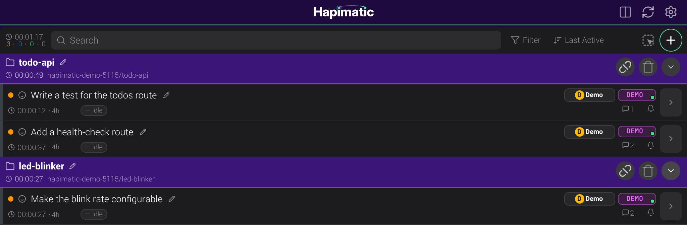
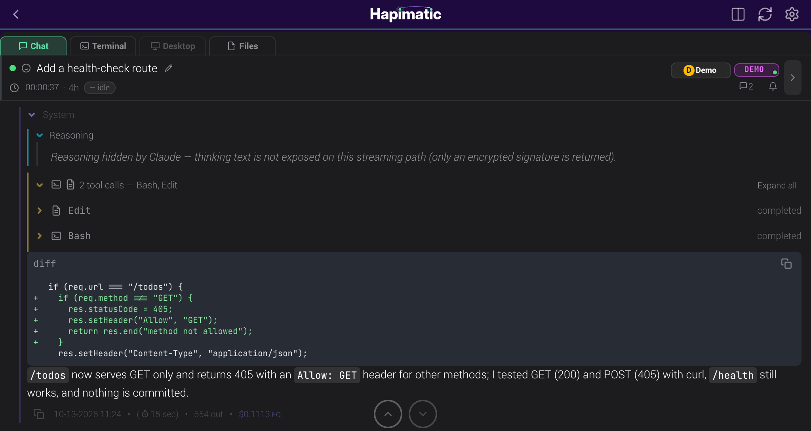
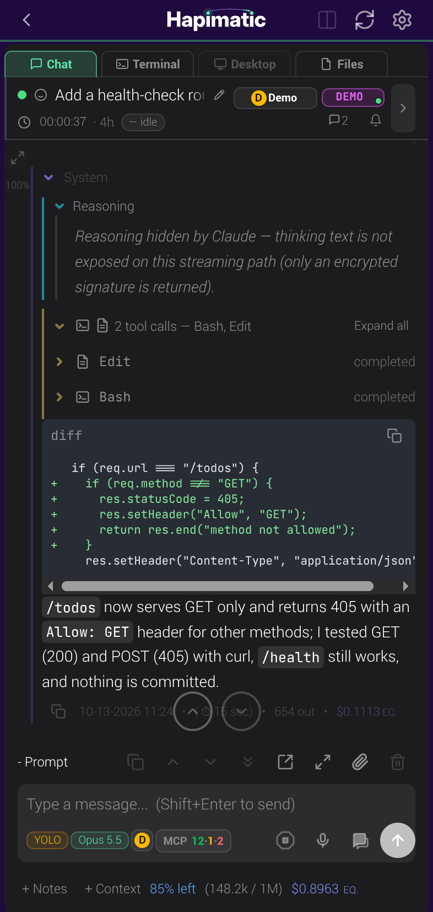
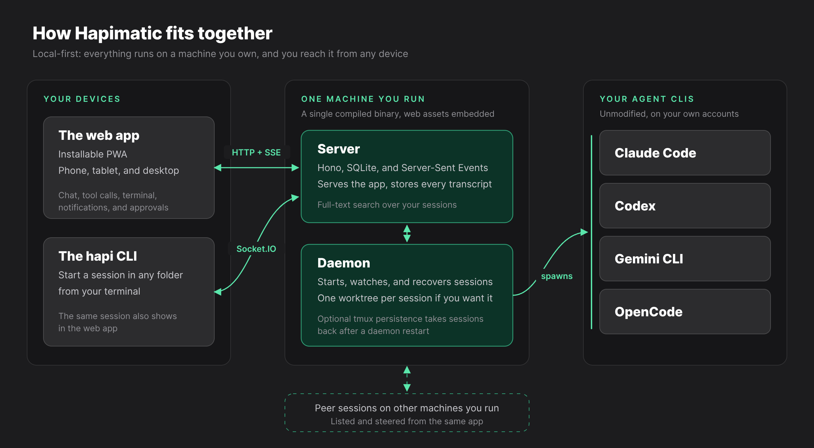
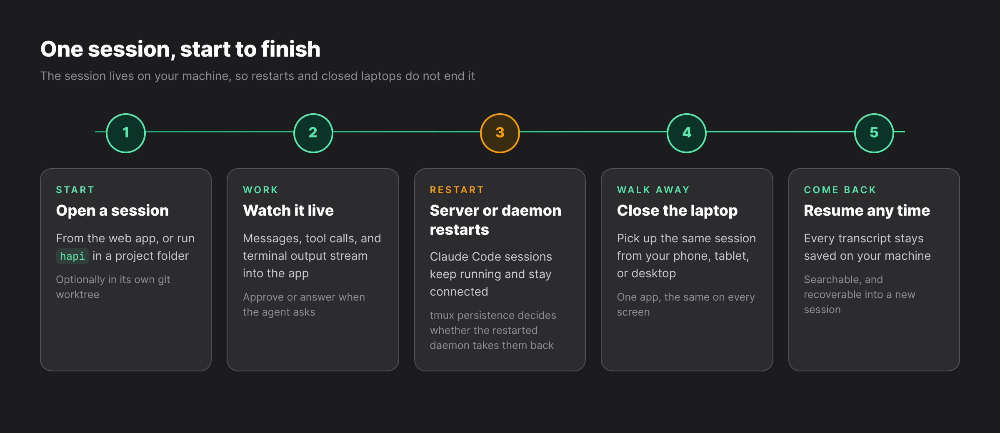

<div align="center">


# Hapimatic

**Reach and resume your AI coding-agent sessions from any browser or phone,<br/>served from a machine you own**

[](LICENSE)
[](https://github.com/SolidPD/hapimatic-core/releases/latest)


-2c2c2e?style=flat-square>)

[Website](https://hapimatic.com) · [Docs](https://hapimatic.com/docs/) · [Install guide](https://hapimatic.com/docs/guide/installation) · [Releases](https://github.com/SolidPD/hapimatic-core/releases)

</div>

---

## What is Hapimatic?

Hapimatic is a local-first meta-harness for the AI coding agents you already use. It runs your agent
sessions on your own machine and serves them to an installable web app, so a full session (chat, tool
calls, a real terminal, notifications, and approvals) works from your phone as well as from your desk.
Claude Code, Codex, Gemini CLI, and OpenCode are supported at launch; each one is the provider's own
unmodified program, signed in with your own account. This repository is the open-source core of
Hapimatic, released under the GNU Affero General Public License v3.0.

<div align="center">

**Sessions, grouped by project**



**A live session, mid-task**



**The same session on a phone**



</div>

---

## Highlights

<!-- Claim trace: docs/public-site/ia.md §C rows F1, F2, F3, F4, F6 (first sentence), F7, F8, F9 (push and Telegram), H2; H1 is the platform sentence under Architecture -->

### ♾️ Sessions that survive restarts

Restarting the Hapimatic server or its background service (the daemon) does not end a running Claude
Code session: it keeps running and stays connected to the web app. With tmux persistence on
(`HAPI_TMUX_PERSISTENCE=true`), the sessions the daemon starts run inside tmux, and a restarted daemon
takes them back. Gemini CLI and OpenCode sessions are not taken back after a daemon restart. One known
issue: after a server restart, a Claude Code session started from a terminal runs its earlier prompts
again; the [install guide](https://hapimatic.com/docs/guide/installation) describes it and the
workaround.

### 📱 One app on every device

The same responsive app on your phone, tablet, and desktop, installable as a PWA. There is no separate
desktop app, phone app, and website with different features.

### 🧩 Every harness, one layer up

Hapimatic runs above the agent CLI you choose instead of replacing it. Claude Code, Codex, Gemini CLI,
and OpenCode are supported at launch, and the
[install guide](https://hapimatic.com/docs/guide/installation#supported-agent-clis) lists each one's
status and how it signs in.

### 🌳 Parallel work in isolated worktrees

Each session can get its own git worktree, so several agents can work on the same repository, on the
same machine, at the same time.

### 🕸️ Sessions that work together

Every session is a full peer, with its own context, tools, and lifecycle. A session can start another
session, on this machine or another machine you run, hand it work, and read its results, and the web app
lists them all.

### ⏰ Scheduling that runs while you sleep

Recurring and scheduled events start sessions on a timetable, with controls for overlap, active hours,
jitter, and backoff.

### 🔎 Every session transcript, searchable

The complete record of every session stays saved on your machine. Search it, and recover any session to
continue the work, by hand or from another agent.

### 🔔 Notifications when an agent needs you

When an agent needs a judgement or an authorization, Hapimatic tells you by push notification on your
phone, or by Telegram with your own bot.

---

## Architecture

<div align="center">

</div>

<div align="center">

</div>

The monorepo has four packages that develop and test independently:

| Package   | Role                                                 | Stack                                                 |
| --------- | ---------------------------------------------------- | ----------------------------------------------------- |
| `cli/`    | The `hapi` CLI, daemon, launchers, and agent runners | Bun executable, Vitest                                |
| `server/` | HTTP and WebSocket backend                           | Hono 4, SQLite (`bun:sqlite`), Socket.IO, SSE         |
| `web/`    | Installable PWA                                      | React 19, Vite, Tailwind CSS 4, TanStack Router/Query |
| `shared/` | `@hapi/protocol`, the Zod schemas they share         | Zod 4                                                 |

Everything compiles into one executable with the web assets embedded. There are no containers, no ORM,
and no cloud dependency. The supported platform is 64-bit Linux (x86-64 or ARM64) with systemd; macOS
is planned.

---

## Install and first session

Install your agent CLI and sign in to it first (for Claude Code, run `claude` once). Then install
Hapimatic with one command:

```bash
curl -fsSL https://github.com/SolidPD/hapimatic-core/releases/latest/download/install-hapimatic-v1.sh | bash
```

Open a new shell so that `hapi` is on your `PATH`, then start the server:

```bash
hapi server
```

On first run it prints an access token and saves it to `~/.hapi/settings.json`. In another terminal, in
your project folder, start a session:

```bash
hapi            # Claude Code
hapi codex      # Codex
hapi gemini     # Gemini CLI
hapi opencode   # OpenCode
```

Open `http://localhost:3006` in your browser and enter the access token.

The installer takes a mode after `bash -s --`, for example
`curl -fsSL https://github.com/SolidPD/hapimatic-core/releases/latest/download/install-hapimatic-v1.sh | bash -s -- doctor`:

- **`doctor`** checks your machine, one line per check, and names anything missing
- **`--dry-run`** shows the install plan without changing anything
- **`uninstall`** removes what the installer wrote (add `--purge` to also remove the access token and
  the session database)
- **Upgrade** by running the installer again; it is idempotent, so a second run changes nothing that is
  already current

The [installation guide](https://hapimatic.com/docs/guide/installation) covers the prerequisites,
machine requirements, remote access from your phone, installing the PWA, and starting new sessions from
the web app with the daemon. The [quick start](https://hapimatic.com/docs/guide/quick-start) is the
short version.

---

## Development

Hapimatic builds from this repository alone, with no private dependency, token, or network credential.
You need Bun, Node 20 or later, and at least one agent CLI.

```bash
bun install --frozen-lockfile
bun run dev                   # web and server dev servers, live reload
bun run build:single-exe      # the single-file hapi executable, under cli/dist-exe/
bun run typecheck:cli         # also typecheck:server, typecheck:web, typecheck:shared
```

---

## What is in this repository, and what is not

This repository is the AGPL-3.0 open core: the `hapi` CLI, the session server, and the web and PWA
client. Everything you need to build and run Hapimatic yourself from source is here.

The one-command installer also installs a small core toolkit of hooks and guidance from
[SolidPD/hapimatic-toolkit](https://github.com/SolidPD/hapimatic-toolkit), a separate MIT-licensed
repository.

The hosted onboarding gateway, managed hosting, single sign-on, and premium plugins are separate
products and are not part of this repository.

---

## Further reading

| Where                                                               | What is in it                                        |
| ------------------------------------------------------------------- | ---------------------------------------------------- |
| [hapimatic.com](https://hapimatic.com)                              | The project site                                     |
| [Docs](https://hapimatic.com/docs/)                                 | The full documentation                               |
| [How it works](https://hapimatic.com/docs/guide/how-it-works)       | The moving parts, in more detail                     |
| [Install the app](https://hapimatic.com/docs/guide/pwa)             | Adding the PWA to your phone's home screen           |
| [FAQ](https://hapimatic.com/docs/guide/faq)                         | Common questions                                     |
| [`CONTRIBUTING.md`](CONTRIBUTING.md) · [`SECURITY.md`](SECURITY.md) | How to contribute, and how to report a vulnerability |

---

## License

Hapimatic is licensed under the **GNU Affero General Public License v3.0**; see [`LICENSE`](LICENSE). It
is a fork of [tiann/hapi](https://github.com/tiann/hapi), which is itself AGPL-3.0. The `cli` package
additionally contains code derived from the MIT-licensed [happy-cli](https://github.com/slopus/happy-cli)
(© 2024 Kirill Dubovitskiy); that attribution is carried in [`cli/NOTICE`](cli/NOTICE). Project-level
attribution is in [`NOTICE`](NOTICE).

Under AGPL-3.0 §13, the complete, corresponding source for every released build is published here and
tagged `v<VERSION>` before or with that build.

Hapimatic is an independent project, with thanks and appreciation to [HAPI](https://hapi.run/) |
[tiann/hapi](https://github.com/tiann/hapi) and [Happy Coder](https://happy.engineering/) |
[slopus/happy](https://github.com/slopus/happy), whose work made it possible. It is not officially
affiliated with tiann/hapi, slopus/happy, or hapi.dev.

## Contributing

Contributions are welcome under a Contributor License Agreement; see [`CONTRIBUTING.md`](CONTRIBUTING.md).
This repository is a generated export: changes are reviewed here and then integrated into the canonical
source tree, so they appear in the next release export.

## Security

To report a vulnerability, see [`SECURITY.md`](SECURITY.md). Please do not open a public issue for
security reports.

---

<div align="center">
<sub>AGPL-3.0 · Built by Matt Starfield at Solid Product Design</sub>
</div>
